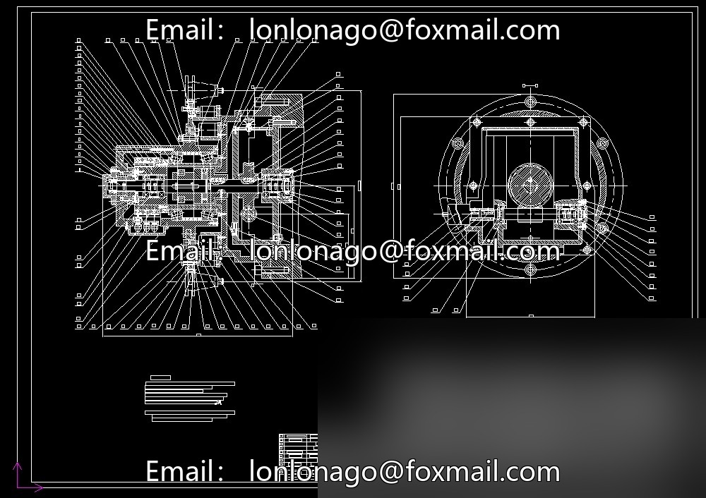
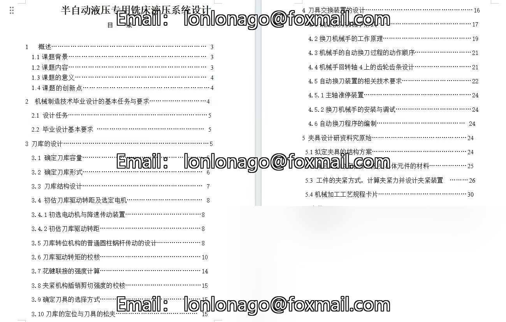
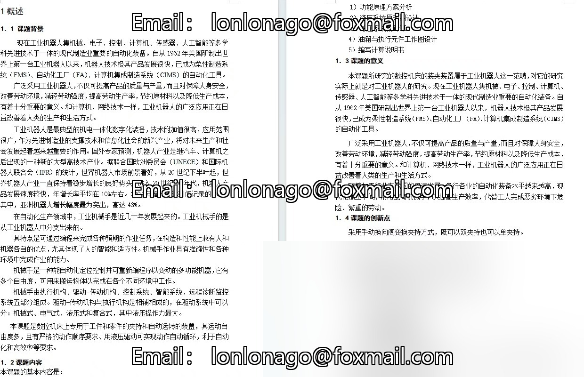

# Semi-automatic hydraulic dedicated milling machine hydraulic system design

## Body

Semi-automatic hydraulic special-purpose milling machine hydraulic system design system design diagram system design CAD drawing
453   Including (papers + DWG drawings), please refer to the accompanying figures

The content covers a semi-automatic hydraulic milling machine hydraulic system design, with related papers, DWG diagrams, CAD drawings and technical notes.

<!-- AI_ENRICHED -->

## Images

## Payment

Here is a pay link on Stripe ( https://buy.stripe.com/3cs8yP7sY87d0vu9AB ). Please contact me lonlonago@foxmail.com after funding $89, and I will send you a complete data files , thank you!

